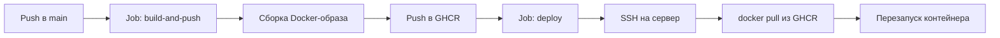

# Деплой приложения

В проекте настроен автоматический деплой через GitHub Actions. Workflow описан в
[`.github/workflows/docker-deploy.yml`](.github/workflows/docker-deploy.yml).

## Как это работает



Workflow запускается:

- при push в ветку `main`;
- вручную через `Actions` → `Build and Deploy` → `Run workflow`.

Изменения в других ветках (например, `Develop`) деплой не запускают — сначала нужно
смержить их в `main`.

## Требования

### Секреты репозитория

Добавьте секреты в
`Settings` → `Secrets and variables` → `Actions`:
<https://github.com/rmtatarinov-netizen/Actions/settings/secrets/actions>

| Секрет | Обязательный | Назначение |
|---|---|---|
| `SSH_HOST` | да | IP-адрес или домен сервера |
| `SSH_USER` | да | пользователь для SSH |
| `SSH_PRIVATE_KEY` | да | приватный SSH-ключ (содержимое файла целиком) |
| `SSH_PORT` | нет | порт SSH, по умолчанию `22` |

### Удалённый сервер

- установлен Docker;
- пользователь из `SSH_USER` может запускать `docker` (входит в группу `docker`
  или имеет соответствующие права);
- порт `8000` свободен и доступен снаружи (если используется firewall);
- SSH-доступ по ключу.

### Права workflow

Workflow использует стандартный `GITHUB_TOKEN`:

```yaml
permissions:
  contents: read
  packages: write
```

Этого достаточно для push образа в GitHub Container Registry (GHCR). На сервере
этот же токен используется для `docker login` и скачивания образа.

## Первичная настройка сервера

Пример для Ubuntu:

```bash
sudo apt update
sudo apt install -y docker.io
sudo systemctl enable --now docker

sudo usermod -aG docker "$USER"
newgrp docker

docker run --rm hello-world
```

Если включён firewall, откройте порт приложения:

```bash
sudo ufw allow 8000/tcp
```

Для деплоя по SSH создайте отдельную пару ключей:

```bash
ssh-keygen -t ed25519 -C "github-actions" -f gh_actions_deploy
```

Публичный ключ (`gh_actions_deploy.pub`) добавьте на сервер в
`~/.ssh/authorized_keys`, а содержимое приватного ключа (`gh_actions_deploy`) —
в секрет `SSH_PRIVATE_KEY`.

Проверьте подключение вручную:

```bash
ssh -i gh_actions_deploy <SSH_USER>@<SSH_HOST>
```

## Job 1: Build and push image

Файл `.github/workflows/docker-deploy.yml`, job `build-and-push`.

Что происходит:

1. Checkout репозитория.
2. Формируется имя образа: `ghcr.io/<owner>/<repo>` в нижнем регистре.
3. Настраивается Docker Buildx.
4. Выполняется логин в `ghcr.io` от имени `github.actor` с `GITHUB_TOKEN`.
5. Образ собирается по `Dockerfile` и пушится с двумя тегами:
   - полный SHA коммита — используется для деплоя;
   - `latest` — для удобства.
6. Слои кэшируются через GitHub Actions (`type=gha`).

Итоговый образ для деплоя:

```text
ghcr.io/rmtatarinov-netizen/actions:<full-commit-sha>
```

## Job 2: Deploy over SSH

Job `deploy` запускается только после успешного `build-and-push`.

1. Проверяются обязательные секреты. Если чего-то не хватает, job падает с
   аннотацией вида `Missing repository secret: SSH_HOST`.
2. Устанавливается SSH-соединение через `appleboy/ssh-action`.
3. На сервер передаются переменные:
   - `IMAGE` — полное имя образа с SHA;
   - `GHCR_USER` — пользователь GitHub;
   - `GHCR_TOKEN` — `GITHUB_TOKEN` текущего запуска;
   - `CONTAINER_NAME` — `fastapi-time`.
4. На сервере выполняются команды:

```bash
echo "$GHCR_TOKEN" | docker login ghcr.io -u "$GHCR_USER" --password-stdin
docker pull "$IMAGE"

docker stop "$CONTAINER_NAME" || true
docker rm "$CONTAINER_NAME" || true

docker run -d \
  --name "$CONTAINER_NAME" \
  --restart unless-stopped \
  -p 8000:8000 \
  "$IMAGE"

docker image prune -f
docker logout ghcr.io
```

Контейнер пересоздаётся при каждом деплое. Благодаря `--restart unless-stopped`
он поднимается автоматически после перезагрузки сервера или падения процесса.

## Запуск деплоя вручную

1. Откройте `Actions` → `Build and Deploy`.
2. Нажмите `Run workflow` и выберите ветку `main`.
3. Либо перезапустите неудачный запуск: `Re-run failed jobs`.

Ссылка на запуски:
<https://github.com/rmtatarinov-netizen/Actions/actions/workflows/docker-deploy.yml>

## Проверка после деплоя

На сервере:

```bash
docker ps
docker logs --tail 100 fastapi-time
```

Проверка приложения:

```bash
curl http://<SSH_HOST>:8000/
curl http://<SSH_HOST>:8000/time
curl http://<SSH_HOST>:8000/date
```

Swagger UI:

```text
http://<SSH_HOST>:8000/docs
```

## Откат на предыдущую версию

Образ с предыдущим SHA остаётся в GHCR, поэтому откат можно выполнить вручную на
сервере. Для логина нужен токен с правом `read:packages` (например, PAT), так как
`GITHUB_TOKEN` действует только во время запуска workflow.

```bash
echo "<TOKEN>" | docker login ghcr.io -u <GITHUB_USER> --password-stdin

IMAGE="ghcr.io/rmtatarinov-netizen/actions:<previous-sha>"
docker pull "$IMAGE"
docker stop fastapi-time || true
docker rm fastapi-time || true
docker run -d \
  --name fastapi-time \
  --restart unless-stopped \
  -p 8000:8000 \
  "$IMAGE"
```

## Траблшутинг

| Симптом | Причина и решение |
|---|---|
| `Missing repository secret: ...` | Не добавлен секрет в настройках репозитория |
| `Permission denied (publickey)` | Неверный `SSH_PRIVATE_KEY`, ключ не добавлен в `authorized_keys` или указан не тот `SSH_USER` |
| `permission denied while trying to connect to the Docker daemon` | Пользователь не в группе `docker`; перелогиньтесь или выполните `newgrp docker` |
| `port is already allocated` | Порт `8000` занят другим контейнером или процессом |
| `denied: denied` при `docker pull` | Нет доступа к пакету GHCR или истёк токен |
| Workflow не запустился после push | Push был не в `main`; проверьте ветку и настройки workflow |
| Образ не скачивается на сервере | Пакет в GHCR приватный, а токен не имеет `read:packages` |
| Контейнер сразу завершился | Смотрите `docker logs fastapi-time`; проверьте `Dockerfile` и зависимости |

## Безопасность

- Не храните приватные ключи и токены в репозитории.
- `GITHUB_TOKEN` живёт только во время запуска workflow; после деплоя выполняется
  `docker logout`.
- Для ручных операций на сервере используйте отдельный PAT с минимальными правами
  (`read:packages`).
- Рекомендуется защитить ветку `main` и деплоить только через pull request.
